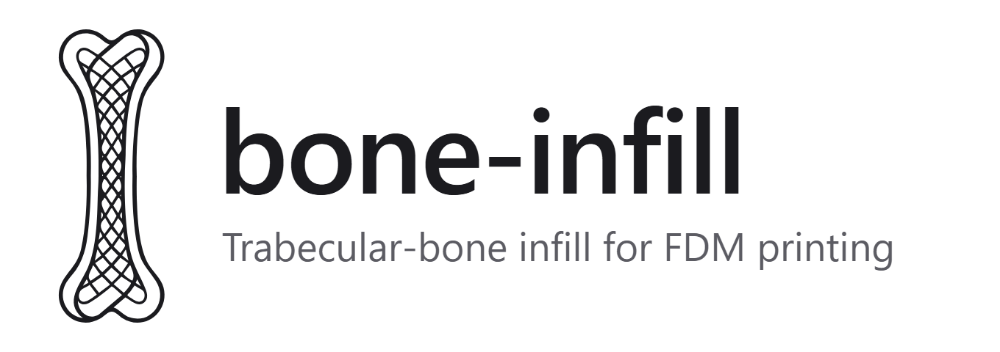
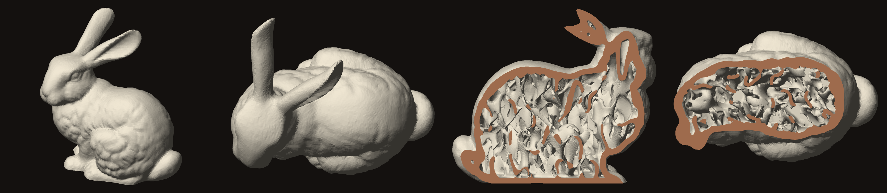

<h1 align="center">
  <picture>
    <source media="(prefers-color-scheme: dark)" srcset="docs/brand/png/lockup-dark.png">
    
  </picture>
</h1>

Fills any closed 3D model with a **trabecular-bone lattice** that an FDM printer can build
without internal supports: a solid skin ("cortical bone") around perforated, mostly vertical
sheets that thin out into rods where little material is needed.



It is a Rust rewrite of the Python proof of concept in `../bone-bracket`, with the generation
reworked around printability. On the same models and the same check it is 3 to 10 times
faster and leaves from 1.8 to 130 times less unsupported material inside the part
(see [Results](#results)).

## Quick start

```bash
cargo build --release
```

```bash
target/release/bone-infill generate model.stl
```

Or use it from the browser:

```bash
target/release/bone-infill serve
```

That opens the [web app](#web-app): load a model, move the parameters, look at the result,
download it. From the command line, `generate` writes `out/model_bone.3mf` and prints a
printability report. Z is the print direction:
orient the model before generating, because the lattice is shaped for that orientation.

```bash
# finer lattice, with a preview image next to the output
bone-infill generate bunny.stl --cell 10 --preview

# leave the top and bottom without skin to show the lattice, thicker skin,
# and reinforce a sphere of radius 20 mm around (0, 120, 10)
bone-infill generate bracket.stl --open=+z,-z --shell 4 --cell 17 --load 0,120,10,20

# check any mesh, for example one made by another tool
bone-infill analyze part.3mf --reference original.stl --shell 2 --map worst_layer.png

# interactive 3D viewer for the result, or for any mesh
bone-infill generate bunny.stl --viewer
bone-infill view part.3mf
```

Print the result with 100 % infill (the part already is the infill) and no supports inside.
Overhangs of the model's own outer surface still need the slicer's usual supports.

## Options

`bone-infill generate <MODEL> [OPTIONS]`. The input is STL (binary or ASCII) or 3MF.

| Option | Default | Meaning |
|---|---|---|
| `-o, --out` | `out/<model>_bone.3mf` | Output, `.3mf` or `.stl` |
| `--shell` | 2 | Skin thickness (mm) |
| `--cell` | 6 | Cell size (mm); smaller is finer |
| `--density` | 0.28 | Solid fraction of the lattice region |
| `--open=FACES` | none | Faces without skin, e.g. `--open=+z,-z` |
| `--load X,Y,Z,R` | none | Reinforced sphere; repeatable |
| `--stretch-dir DX,DY,DZ` | none | Main load direction: pores are elongated along it |
| `--stretch` | 1.6 | Elongation along `--stretch-dir` |
| `--z-elongation` | 2 | Pore elongation along Z; higher means steeper sheets |
| `--skin-boost` | 0.6 | Extra density next to the skin |
| `--min-wall` | 0.8 | Minimum sheet thickness (mm) |
| `--hole-ratio` | 0.45 | Size of the perforations relative to the cell |
| `--perforation SPARSE,DENSE` | 0.39,0.27 | Perforated share of the sheets where the lattice is sparsest and densest; higher gives rods, lower gives plates |
| `--bandwidth` | 0.35 | Irregularity of the pattern: 0 is almost periodic |
| `--blend` | 1.2 | Fillet radius where lattice and skin merge (mm) |
| `--load-boost` | 0.8 | How much denser the lattice gets inside a `--load` region |
| `--max-overhang` | 45 | Steepest lattice overhang, degrees from vertical |
| `--max-bridge` | 4 | Longest bridge (mm); both ends must be supported |
| `--bridge-width` | 0.8 | Narrowest band of strands accepted as a bridge (mm) |
| `--no-vaults` | | Do not build vaults under inner ceilings |
| `--vault-slot` | 0.5 | Slot left under flat roofs, as a share of `--max-bridge`; lower closes roofs more and uses more material |
| `--min-feature` | 0.6 | Remove lattice features thinner than this (mm) |
| `--no-density-compensation` | | Do not regenerate when carving misses the density |
| `--voxel` | 0.3 | Voxel size (mm) |
| `--max-voxels` | 60 | Voxel budget in millions; larger parts get a coarser voxel |
| `--waves` | 128 | Plane waves per random field; more is smoother statistics, slower |
| `--simplify` | voxel / 4 | Mesh simplification tolerance (mm); 0 disables |
| `--seed` | 7 | Another seed gives another pattern with the same rules |
| `--preview` | | Also write a PNG (outside, top, two section cuts) |
| `--viewer` | | Also write an interactive 3D viewer (`.html`), see below |
| `--report FILE` | | Write generation and printability data as JSON |
| `--no-check` | | Skip the printability check |
| `--layer-height` | 0.2 | Layer height assumed by the check (mm) |
| `--min-island-area` | 0.2 | Mid-air regions smaller than this (mm²) are reported as specks |
| `--threads` | all cores | Worker threads |

`bone-infill analyze <MESH>` takes `--reference`, `--shell`, `--layer-height`, `--resolution`,
`--max-overhang`, `--max-bridge`, `--bridge-width`, `--min-island-area`, `--json`, `--map FILE`
and `--map-z Z`.

Every option has a field of the same meaning in `Params` (generation) or `AnalyzeParams`
(check) for use as a library. A few constants stay internal because they are tuning of the
implementation rather than of the result: the 5° safety margin of the vault slope, the angle
that defines a pore's medial axis, the falloff distances of the density map, and the base
sheet fraction that the density calibration shifts anyway.

## Web app

`bone-infill serve` starts a local server (127.0.0.1 only, port 8787, `--port` to change it)
and opens the app in the browser. Inputs are on the left (model and parameters), outputs on
the right (report, download, view controls), the model in between:

- **Load** an STL or 3MF by dropping it on the page. It must be the solid model, with Z as
  the print direction. "Try a sample" loads a proximal femur (`src/web/ui/sample.stl`, made
  from a full-resolution mesh by `cargo run --release --example sample_model`).
- **Open faces**: the Top and Bottom buttons (and the four sides) leave those faces without
  skin, which is what makes the lattice visible in a slab; the download is exported that way.
- **Parameters** are those of the command line, grouped (lattice, printability, shape,
  resolution), with Low / Medium / High presets on top and an info card next to each one.
  Reinforced spheres and the load direction (`--load`, `--load-boost`, `--stretch-dir`,
  `--stretch`) are left to the command line: their effect is hard to judge without knowing
  how the part will be loaded. With "Update automatically" ticked, the part is rebuilt after
  every change; a cube takes a few tenths of a second, the 80 mm bunny about 3 s, so for
  large parts you may prefer the Generate button.
- **Look**: orbit, pan and zoom; section along X, Y or Z; flat or smooth shading; overhang
  colouring; switch between the result and the original. Progress is shown on the model
  itself while a part is being generated. The report shows density, weight and the printability
  figures, and one button sections the part at its worst layer.
- **Download** the result as 3MF or STL.

All computation runs natively in the server process, on all cores; the page only draws. One
model and one result are held in memory, so it is a tool for one person on their own
machine, not something to expose on a network.

The page is a React app built on a shared studio kit, in [`ui/`](ui/README.md). Its built
form, one self-contained HTML file, is committed as `src/web/ui/index.html` and embedded in
the binary, so building the crate needs no Node.js. To change the interface:

```bash
cd ui && npm install && npm run dev
```

```bash
cd ui && npm run build
```

The first serves the page with hot reload, forwarding its API calls to a running
`bone-infill serve --port 8791`; the second rebuilds `src/web/ui/index.html`.

### In the browser, with no server

[`wasm/`](wasm/README.md) holds a WebAssembly port of the same app: three static files that
run the algorithm in a Web Worker. It is a working prototype that reuses this code
unchanged; it is single-threaded (the 80 mm bunny takes about 12 s instead of 3) and limited
to 16 million voxels. The native program remains the reference.

```bash
cargo run --release --example wasm_site
```

Pushing to `main` publishes it on GitHub Pages (`.github/workflows/pages.yml`); see
[Publish on GitHub Pages](wasm/README.md#publish-on-github-pages).

## Showing the lattice: sections

The lattice is inside the part, so a closed model looks exactly like the original. The
pieces that show it best are slices: a slab of constant thickness, printed lying down, with
both faces left without skin. `section` cuts such a slab out of any closed model:

```bash
# a slab 18 mm thick across the middle of the model (plane normal +Y, model Z up)
bone-infill section model.stl --thickness 18

# any plane: a point on it, its normal, and the direction that should end up as "up"
bone-infill section femur.stl --through 117.3,14.6,671.1 --normal 0.408,-0.889,-0.210     --up 0.562,0.064,0.825 --thickness 18 --below 125

bone-infill generate out/femur_section.stl --open=+z,-z --shell 2.4 --cell 10 --density 0.2     --load 22,125,9,15 --stretch-dir 0.4,-0.92,0 --stretch 1.8
```

The slab comes out lying flat (the plane's normal becomes Z) with its corner at the origin,
so `--load` and `--stretch-dir` for the next step are given in the slab's own coordinates.
`--below` and `--above` crop it along `--up`, and `--scale` resizes the model first.

The second example is the frontal section of a femur: the plane contains the shaft axis and
the centre of the head, the load sphere densifies the head, and the pores are elongated
along the line the body's weight follows from the head to the inner wall of the shaft.

If you need a model that is entirely your own, `cargo run --release --example femur` writes
`models/femur_section.stl`: the same kind of slab with an outline built from a few circles
and capsules instead of a scan.

## Interactive viewer

`--viewer` (or `bone-infill view <MESH>`) writes one self-contained `.html` file next to the
output. It embeds the geometry and a small WebGL 2 renderer, so it opens from disk in any
current browser, with no server and no network access.

- **Orbit, pan, zoom**: drag, right-drag (or Shift+drag), wheel. Double-click a point to
  orbit around it.
- **Section** along X, Y or Z with a slider; cut faces are shaded as solid material. Along Z
  the readout gives the printed layer number, and the arrow keys step one layer at a time.
- **Shading**: smooth (the default, with real edges kept sharp) or flat, which shows the
  actual triangles.
- **Overhang colouring**: down-facing surfaces are painted by their angle from vertical
  (under 30°, 30–45°, 45–60°, over 60°), which shows in 3D where the report's numbers come
  from.

The page is a snapshot of one result: changing a parameter means generating again. The bunny
(320 000 triangles) is a 6 MB file.

## Demo renders in Blender

[`blender/studio.blend`](blender/studio.blend) is a photo studio for presentation images and
videos of any model: a seamless round backdrop, five area lights, six cameras (hero, front,
side, top, detail with depth of field, and section), studio materials for the part and Cycles
set up for the GPU. Any model is scaled to the same stage and rests on the floor at the origin,
so lights and cameras work for all of them; the mesh keeps its own coordinates.

Render from the command line (Blender 4.2 or later), with the images going to `out/renders`:

```bash
# hero shot of a result
blender -b blender/studio.blend -P blender/studio_tools.py -- out/bunny_bone.3mf

# every shot, cut open along Y to show the lattice, at a lower quality for a quick look
blender -b blender/studio.blend -P blender/studio_tools.py -- out/bunny_bone.3mf --shots all --cut y --samples 64

# light backdrop, another material, 0.2 mm layer lines, and a 4-second turntable video
blender -b blender/studio.blend -P blender/studio_tools.py -- part.3mf --look light --material "Graphite PLA" --layers 0.2 --turntable

# transparent PNG that keeps only the floor shadow, saving the scene to adjust it by hand
blender -b blender/studio.blend -P blender/studio_tools.py -- part.stl --transparent --save out/part_studio.blend
```

`-- --help` lists every option. `--cut` takes an axis of the model, with an optional side and
position as a share of its extent (`y`, `+x:0.3`, `--cut=-z:0.7`). The cut is real geometry,
made by a Boolean modifier, so the cut faces have the part's own material and are lit like
the rest of it; `--cut-color` paints them in a highlight colour instead. The model file is
not changed, and the `Section Plane` empty that places the cut can also be moved by hand.
`--look` picks the backdrop: `slate` (blue-grey, the default), `warm` (sand), `sage` (green-grey),
`light` (pale grey) or `dark` (near black).

In Blender, allow the file's scripts when it opens (or run `studio_tools.py` from the Text
Editor) to get the **Studio** tab in the sidebar (N): import a model, switch look, material
and section, jump between cameras and render all shots. The scene is generated by
`blender -b --factory-startup -P blender/build_studio.py`; change that script, not the
`.blend`, to change the studio for good.

## The printability report

After generating, the finished mesh is re-sliced at the real layer height on a 0.1 mm raster,
independently of the voxel field it came from, and every layer is compared with the one below:

```
printability at 0.20 mm layers (limits: 45 deg overhang, 4.0 mm bridges; raster 0.10 mm):
  unsupported inside :    145.2 mm2  (0.073 % of all printed area) in 385 layers
      of which skin  :     90.9 mm2  (inner ceilings), lattice: 54.3 mm2
  islands in mid-air :        2      (0.6 mm2; plus 30 specks too small to extrude)
  bridges            :    ...
  model's own overhangs (need external supports): 229.0 mm2
```

- **unsupported inside** is material that starts beyond the overhang limit and is not a bridge.
  It is split into skin (inner ceilings) and lattice.
- **islands** are regions that start in mid-air; specks are islands smaller than 0.2 mm².
- **model's own overhangs** exist in the original model too and are the slicer's job.

`--map` draws one layer (by default the worst) with the unsupported pixels in red, which is
the quickest way to find a problem spot before looking at it in the slicer.

## Results

Same models, same parameters, both outputs measured by `bone-infill analyze` with the same
limits (45°, 4 mm bridges, 0.2 mm layers). Machine: Ryzen 7 5800X, 16 threads. Prototype
times are the ones in its README. These runs used the prototype's parameters (16 mm cells,
15.5 % density); the defaults are now finer and denser (6 mm, 28 %), which looks more like
real bone and makes larger meshes.

| Model | Voxels | Unsupported inside: prototype → this | Islands | Time |
|---|---|---|---|---|
| Cube 20 mm | 0.5 M | 172 → 16 mm² | 3 → 0 | 1 → 0.3 s |
| 3DBenchy | 4.2 M | 294 → 163 mm² | 6 → 4 | 7 → 0.7 s |
| Bracket, open ±Z | 12.5 M | 2732 → 21 mm² | 24 → 1 | 21 → 2.5 s |
| Stanford bunny 80 mm | 16.7 M | 2668 → 145 mm² | 30 → 2 | 24 → 2.9 s |
| Vase 200 mm | 60 M | 27025 → 502 mm² | 225 → 12 | 106 → 10.6 s |

Peak memory on the vase is 1.2 GB (1.9 GB in the prototype). Share of the inner down-facing
surface steeper than 45°: bunny 45 % → 8 %, bracket 46 % → 2 %, vase 45 % → 5 %.

What is left is mostly skin, not lattice: places under inner ceilings where vault slots meet,
and small parts such as the Benchy where most of the interior is ceiling.

**These numbers come from the tool's own geometric check, not from a slicer or a printed
part.** Nothing here has been test-printed yet; see [Limitations](#limitations).

## How it works

1. **Voxelise** the mesh and measure the distance to its surface; the outer `--shell`
   millimetres are skin.
2. **Bone field.** Two band-limited random fields, built as sums of plane waves so no global
   FFT is needed: the first gives undulating sheets of uniform thickness, the second
   perforates them. Thickness and perforation follow a density map (more near the skin and
   in load regions) calibrated to the requested density. Waves are elongated along Z, which
   turns the sheets towards vertical.
3. **Overhang filter.** Layer by layer from the bed, lattice survives only within the
   overhang limit of the layer below, or as a band of bridge strands supported at both ends.
   Holes get pointed roofs; anything that only hangs from above is carved away.
4. **Vaults.** Under inner ceilings each pore is narrowed towards its medial axis at the
   printable angle, so the skin above rests on corbelled vaults instead of spanning pores.
5. **Mesh.** Marching cubes, quadric simplification, and assembly. With a closed skin the
   original surface is reused untouched and only the cavities are added.
6. **Check** the result as described above.

[docs/ALGORITHM.md](docs/ALGORITHM.md) explains each step, the reasons behind it, and what
was wrong in the prototype.

## Limitations

- **Not print-tested.** Printability is assessed geometrically. Before trusting a part, look
  at the layer view of your slicer, in particular at the spots `--map` highlights.
- **Inner ceilings are the weak point.** The first skin layer over a vault slot is a bridge of
  up to about half `--max-bridge`, wider where slots meet. Expect some sagging strands on the
  inside of flat roofs, as over any sparse infill.
- **Open faces re-mesh the outside.** With `--open` the whole part is rebuilt from the voxel
  field: flat faces stay flat, but sharp edges are rounded at voxel scale (0.3 mm). With a
  closed skin the outer surface is exactly the input.
- **Bridges are looked for along four directions** (0°, 45°, 90°, 135°), both when generating
  and when checking. A slicer may choose differently.
- **The lattice is anisotropic by design**: sheets are mostly vertical, so the part is
  stiffer along Z than across it. `--z-elongation 1` gives an isotropic lattice at the cost
  of more carving.
- **Thin regions stay solid.** Where the part is thinner than about twice the skin there is
  no room for lattice.
- The 3MF reader takes plain single-mesh files; it ignores transforms and components.
- The density map is a heuristic, not a finite-element result.
- The parametric bracket generator of the prototype (`bone_bracket.py`) is not ported; the
  same part is obtained from a solid bracket with `--open=+z,-z` and `--load`.

## Development

```bash
cargo test
```

```bash
cargo clippy --all-targets
```

| Module | Role |
|---|---|
| `voxelize`, `edt`, `sdf` | Mesh to voxels, distance transforms, exact narrow-band distance |
| `volume` | Inside / skin / core classification, ceilings |
| `noise`, `field` | Plane-wave random fields, bone field, density calibration |
| `support`, `bridge` | Overhang filter, bridge rule, loose and thin feature removal |
| `vault` | Vaults under inner ceilings |
| `isosurface`, `simplify` | Marching cubes, quadric edge collapse |
| `analyze` | Independent printability check |
| `pipeline`, `main` | Orchestration and CLI |
| `io`, `mesh`, `render` | STL / 3MF, mesh utilities, preview renderer |
| `viewer` | Interactive HTML viewer export |
| `section` | Cuts a flat slab out of a model |
| `app`, `schema` | The web app's API, independent of transport, and its parameter form |
| `serve` | Native HTTP server in front of `app` |
| `web/` | Standalone viewer template and theme; `web/ui/` is the built app page |
| `ui/` (npm workspace) | The app's source: a reusable studio kit and the bone-infill app |
| `wasm/` (separate crate) | WebAssembly build of `app` and its browser glue |
