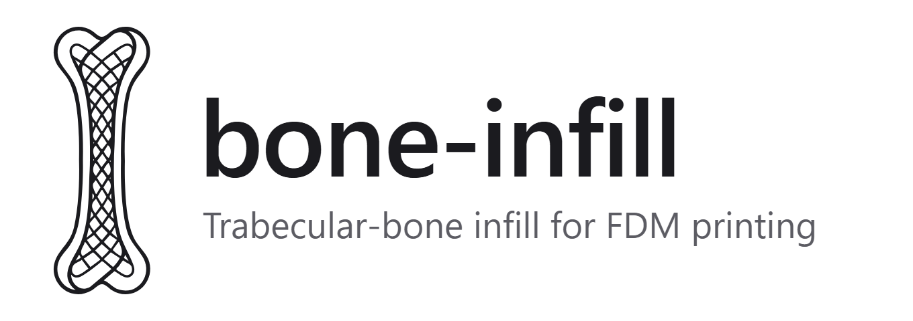

# bone-infill brand

<picture>
  <source media="(prefers-color-scheme: dark)" srcset="png/lockup-dark.png">
  
</picture>

## The logo

A bone drawn as a knot of ribbons. The outline and the inner walls are the **cortical
bone**, the solid skin; between them the walls curl into loops and weave into a net, the
**trabecular bone** the program grows inside a part. One line, no fill: the same idea as the
generator, a solid shell around an open lattice.

`svg/source-original.svg` is the drawing as delivered. Every other file is made from its one
visible path, unchanged; the invisible construction shapes are left out.

## Files

| File | Use |
|---|---|
| `svg/logo.svg` | The logo in ink, for light backgrounds. The master. |
| `svg/logo-bone.svg` | Bone colour, for dark backgrounds (the app). |
| `svg/logo-white.svg`, `svg/logo-jade.svg` | White, and jade for accents. |
| `svg/logo-currentcolor.svg` | Takes the colour of the text around it, for inline use in code. |
| `svg/icon.svg` | App icon: the logo on a rounded ink square. Also the favicon. |
| `svg/icon-maskable.svg` | Full-bleed icon for platforms that crop their own shape. |
| `svg/lockup-dark.svg`, `svg/lockup-light.svg` | Logo, name and tagline side by side, transparent: `dark` for dark backgrounds, `light` for light ones. |
| `svg/social-card.svg` | 1200 × 630 preview for links (GitHub, MakerWorld, social). |
| `png/` | The same as PNG: logo at 1024 px tall, icons at 16 to 512 px, lockups at 2×. |
| `favicon.ico` | 16, 32 and 48 px, for browsers that do not take the SVG. |

The lockups and the social card set the name in the system font (Segoe UI on Windows, San
Francisco on macOS), so the SVGs look slightly different from one system to another; the PNGs
are fixed. Use the PNGs where the result must be exact.

## Colour

The palette of the app ([DESIGN.md](../DESIGN.md)), three roles that are never mixed: cool greys
for the interface, jade for interaction, bone for the part itself.

| Name | Hex | Role |
|---|---|---|
| Ink | `#1b1b1f` | Backgrounds of the app and the icon; the logo on light backgrounds. |
| Bone | `#ede6d6` | The logo on dark backgrounds; the printed part in every render. |
| Jade | `#3dbe8b` | Accents and actions. Never the logo's main colour on large surfaces. |
| Text | `#efeff0` / `#b3b3b4` | The name and the tagline on dark backgrounds. |

The logo is one colour, always. On dark backgrounds use bone or white; on light ones, ink.

## Name

**bone-infill**, lower case, with the hyphen, in the system UI font at semibold. The tagline is
*Trabecular-bone infill for FDM printing* (in the app's schema, `src/schema.rs`).

## Space and size

- **Clear space:** keep free, on every side, at least half the width of the bone.
- **Smallest size:** 24 px tall on screen, 10 mm in print. Below that the net closes up; use
  the icon instead, which holds from 16 px (the favicon).
- The logo is tall (about 1 : 2.8). Place it upright; in a square, use the icon.

## Don't

- Rotate, flip, stretch or squash it.
- Fill it, add outlines, shadows or gradients.
- Put it on a busy photo or a background without contrast.
- Redraw or trace it: use these files.
