# Femur with Real Bone Inside

*A human femur built the way bone is built: a thin solid shell around a spongy lattice. The
lattice was grown by **bone-infill**, a free generator I made that fills any model with
bone that a printer can actually print.*

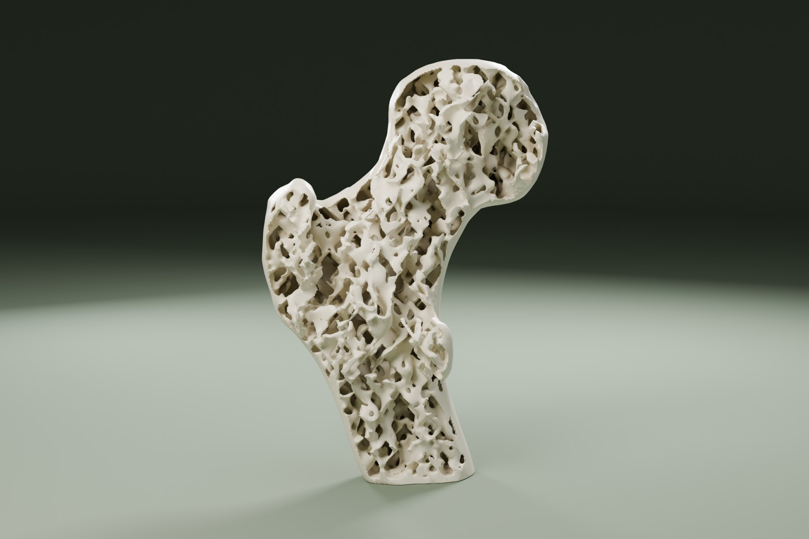

**Two plates, one profile each:**

- **The femur** (Low density): the whole top of the thigh bone, with one side left without skin so the bone shows. About 43 g and 4 h on a Bambu Lab P2S.
- **The bone slice**: a 12 mm section through the same femur, open on both faces, like the bone slices in an anatomy lab. About 22 g and 2.5 h, **no supports at all**.

## The real project: grow printable bone inside any model

This femur is the showcase. What is new is the tool behind it.

Slicers fill a part with a repeating pattern (grid, gyroid, honeycomb) that knows nothing
about the shape around it. **bone-infill** grows a lattice like spongy bone instead: plates
and struts that never repeat, fitted to each model, denser right under the skin. Then it
makes that lattice printable, with no supports inside, and checks every result layer by
layer before you download it.

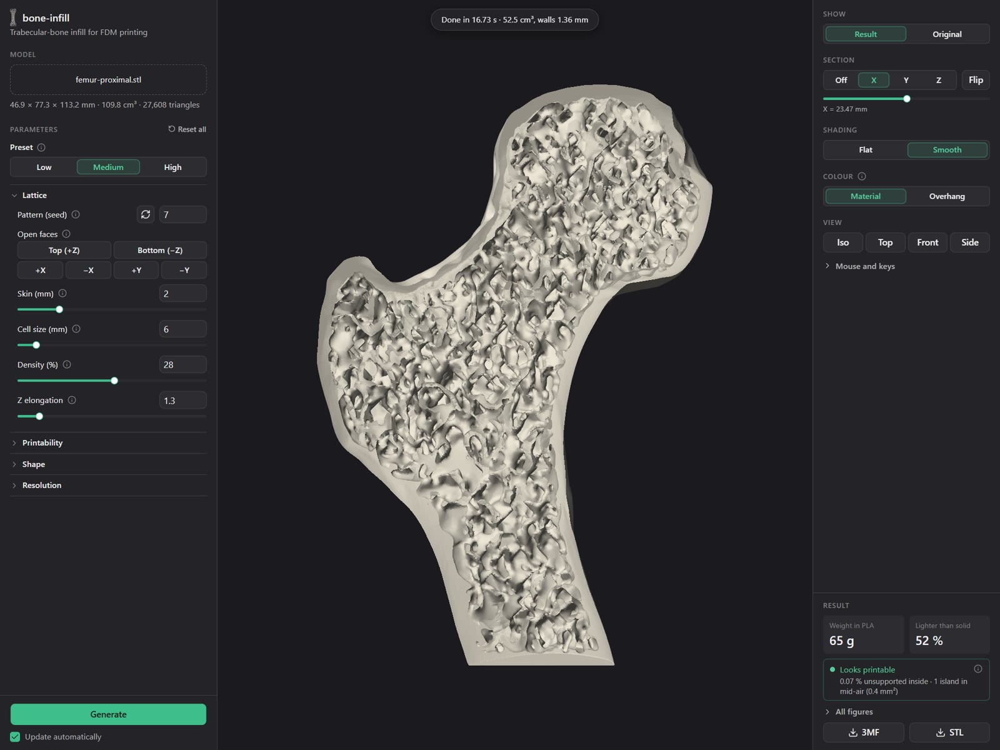

It runs as a web app, entirely in your browser, so your files never leave your computer:

1. Load any STL or 3MF (or press *Try a sample* for this femur).
2. Pick Low, Medium or High, or tune two dozen parameters, each one explained.
3. Look inside with section cuts and read the printability report.
4. Download the result for your slicer. A part like this femur takes about half a minute.

**Try it free:** [jtorregrosa.github.io/trabecular-bone-infill-fdm](https://jtorregrosa.github.io/trabecular-bone-infill-fdm/)
· **Source code (open source):** [github.com/jtorregrosa/trabecular-bone-infill-fdm](https://github.com/jtorregrosa/trabecular-bone-infill-fdm)

It started as a proof of concept in Python and became a fast generator in Rust, with the
printability checker built in. How it learned to print is further down.

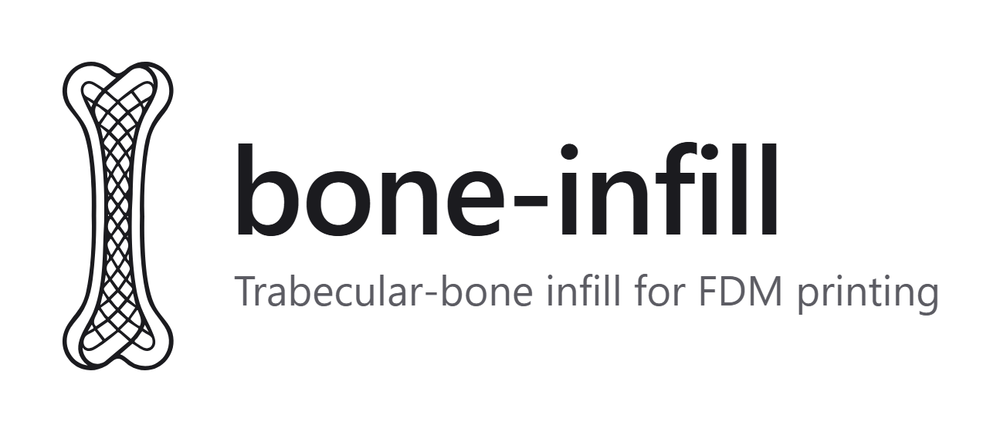

## Printed for real

This is the femur plate, printed in white PLA on a Bambu Lab P2S with the profile included
here.

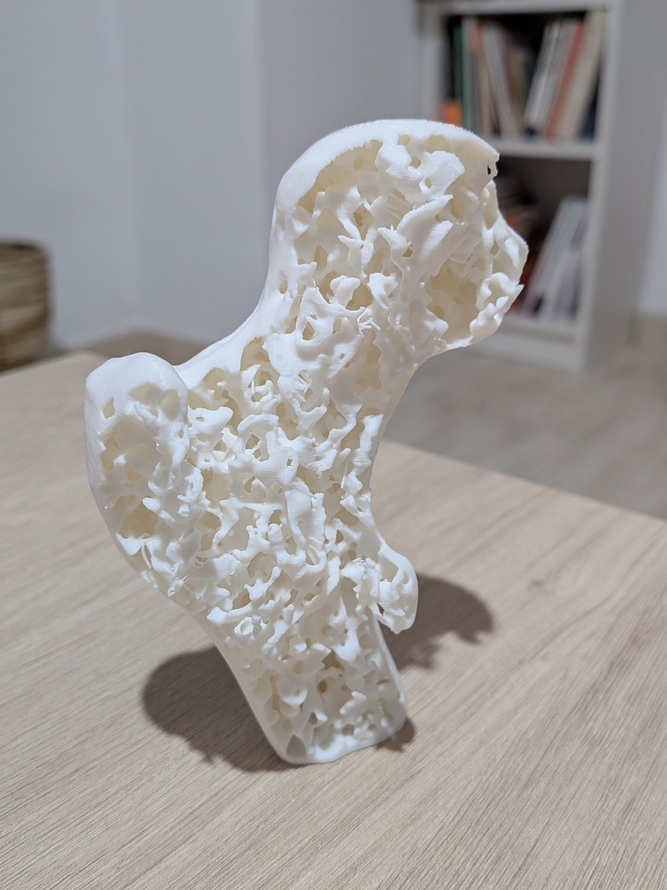

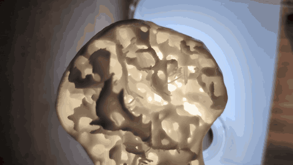

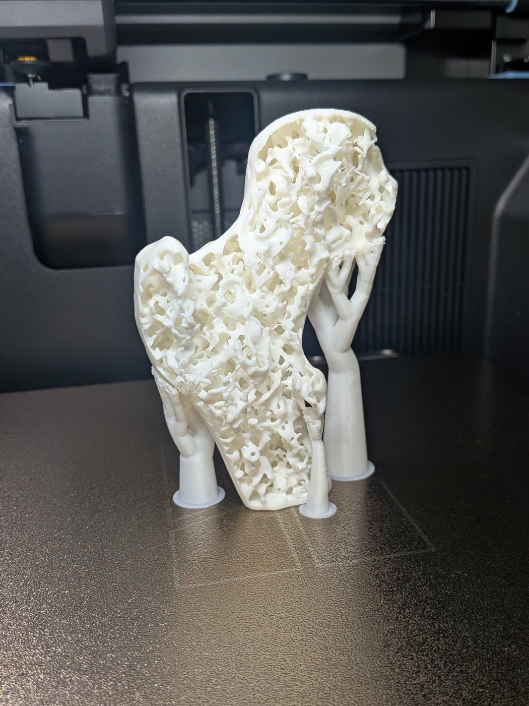

## How nature solved it

Your skeleton has to carry your weight, take the shock of every step and still be light
enough to move. Bone does it with two materials in one:

- a dense outer shell, the **cortical bone**, and
- inside it, a sponge of thin plates and struts, the **trabecular bone**.

Bone puts material only where the loads go and leaves the rest open. It even rebuilds itself
when the loads change (Wolff's law, 1892). In the top of the femur the struts line up so
clearly with the forces that, the story goes, the engineer Karl Culmann recognised in a
femur section the stress lines he had drawn for a crane.

That is the idea copied here: **a strong, light part made the way a bone is made**, instead
of a solid block or a grid infill.

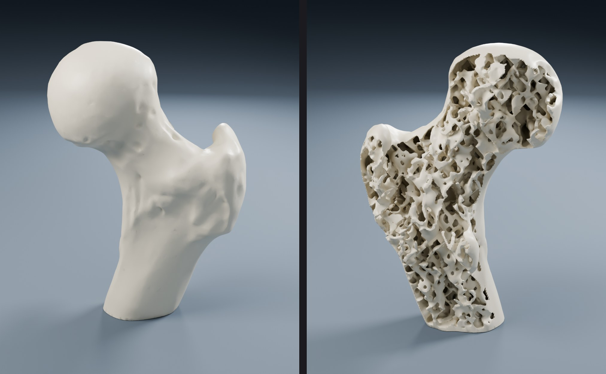

## What this model takes from real bone

- **Cortical shell → solid skin.** A smooth skin 1.6 mm thick (Low) wraps the part, the way
  compact bone wraps the sponge. One side is left open, so you can see in.
- **Trabecular bone → a grown lattice.** Plates and struts in every direction, never
  repeating, grown for this femur by bone-infill. It is not a stock infill or a texture.
- **Plates and rods.** Where the lattice is dense the walls are plates with round holes
  through them; where it is sparse they thin out into rods. Real spongy bone does the same.
- **A soft transition.** The lattice gets denser right under the skin, like the zone where
  compact bone blends into spongy bone.
- **A main direction.** The pores are stretched along one axis. In this femur that axis
  runs roughly along the shaft, the same way the main load-carrying struts of a real femur
  run down from the head.
- **Real porosity.** The three densities are 20, 28 and 36 % solid. Spongy bone at the top
  of the femur is roughly 15 to 40 % bone, depending on the region and on age.

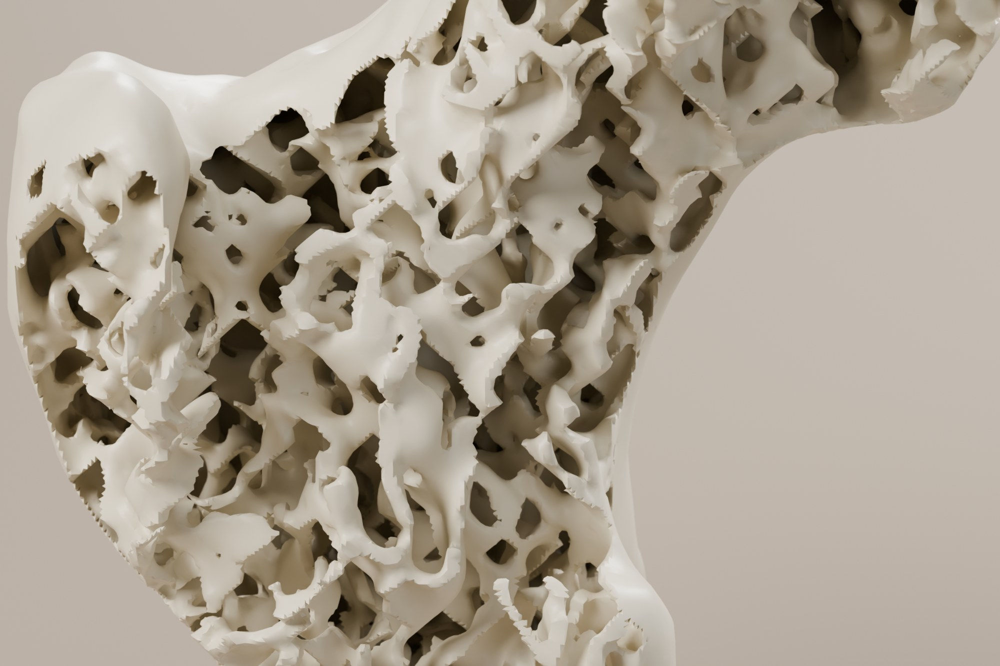

## The hard part: bone ignores gravity, printers don't

A bone grows in all directions at once. A printer builds one thin layer on top of the last,
and every layer needs something under it. A lattice copied freely from bone is full of
struts that lean too far or start in mid-air, deep inside the part, where no support could
ever reach.

So the real work was teaching the lattice to **look like bone and print like a good model**.
The generator follows four rules:

- **Walls stand upright.** The pores are stretched in the print direction, so walls rarely
  lean past 45°.
- **Ceilings get arches.** Under every part of the skin that closes over a hollow, the
  pores turn into pointed vaults, like cathedral arches, so the roof always has something to
  stand on.
- **Nothing floats.** Strands too thin for a 0.4 mm nozzle, loose fragments and strut tips
  that would start on nothing are removed.
- **Every result is checked.** An independent checker slices the finished part layer by
  layer, like your slicer, and measures everything that would print in mid-air.

To see what the rules are worth, I generated the same femur with the rules switched off and
checked both:

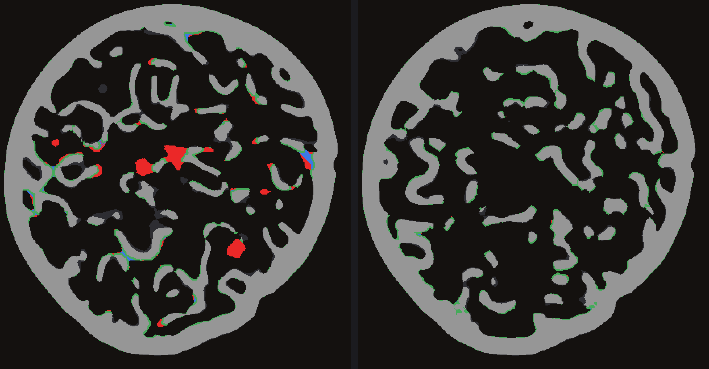

- **Area printed in mid-air:** 2512 mm² without the rules → **201 mm²** with them (−92 %).
- **Floating islands:** 227 → **4**, 1.2 mm² in all, each narrower than one line of plastic.

What is left is a few short spans that bridge without trouble. (Measured on the Medium
density at 0.2 mm layers, 45° overhangs and 4 mm bridges.)

## The bone slice

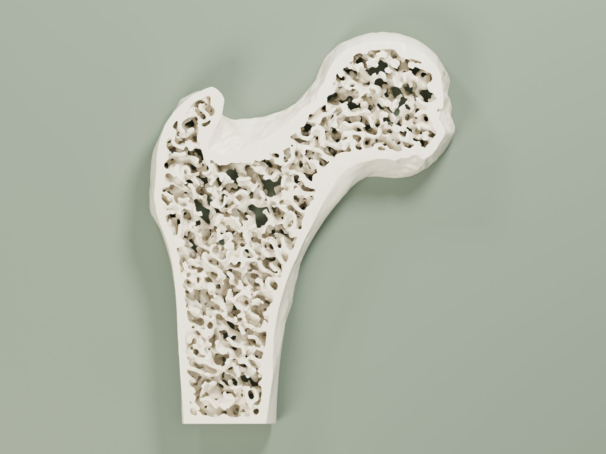

Anatomy collections show bone as thin slices, because that is where the inside makes sense.
This plate is exactly that: a 12 mm slice through the middle of the femur, along the plane
that shows the head, the neck and the greater trochanter.

The lattice is shaped for the direction it prints in, so the order matters. The whole femur
was laid on its back first, filled with bone at Medium density in that position, and only
then cut. The faces show the bone as a real section would, struts cut through, with the
solid skin running unbroken all the way round.

- It lies flat, so the first layer *is* the bone pattern.
- **No supports, no brim needed**: the checker finds no island in mid-air, only one speck of
  0.2 mm² in the whole part.
- Hold it up to a window: you can see right through the pores.

## Three densities, one bone

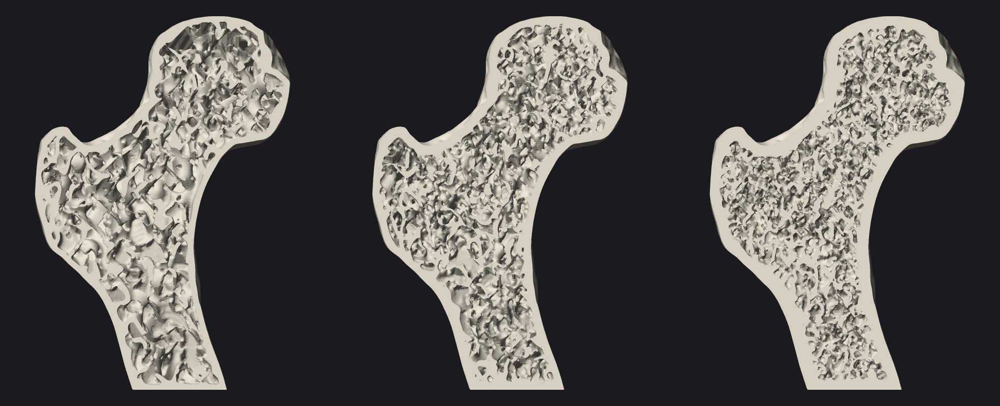

- **Low** (the femur plate): 20 % lattice, 8 mm pores, **61 % lighter** than a solid femur.
  For display and quick prints.
- **Medium** (the slice plate): 28 % lattice, 6 mm pores, 52 % lighter. The balanced one.
- **High:** 36 % lattice, 4.5 mm pores, 40 % lighter. For parts that carry load.

Real pores are smaller, around a millimetre; a nozzle cannot go that fine, so the pattern is
the same at a printable scale. Medium and High are one click away in the free web app.

## Healthy and osteoporotic, from the same program

In osteoporosis, spongy bone loses mass: its plates thin out, break into rods and the
spaces between them grow. Turning down the density in the generator does the same to the
lattice.

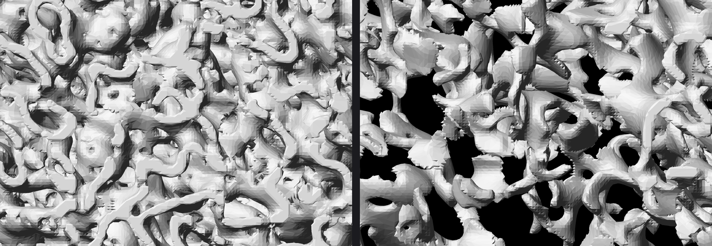

*Not microscope photos: renders of two 60 mm blocks of lattice made by the generator, seen
from above. Left, dense and fine (30 %), like healthy spongy bone. Right, sparse with wide
spaces (8 %), like bone thinned by osteoporosis.*

## What it is good for

- **Teaching.** Pass the slice around a biology, anatomy or physiotherapy class. It shows
  in one look why bones are light and how osteoporosis weakens them.
- **Explaining.** A talking piece for anyone who has to explain a hip fracture or bone loss.
  It is a model for learning, not a medical device.
- **Your own parts.** The same lattice works on any closed model: brackets, figures, lamp
  shades, cosplay props. Leave a face open to show the bone, as in the slice.
  [Try it in your browser](https://jtorregrosa.github.io/trabecular-bone-infill-fdm/).

## Printing

The profiles are for a **Bambu Lab P2S with a 0.4 mm nozzle**, 0.2 mm layers and PLA, and
they suit any well-tuned FDM printer. The part was designed and checked for 0.2 mm layers,
45° overhangs and 4 mm bridges.

**Plate 1, the femur**

- **Orientation:** on its flat base, as provided. The bone leans 20° towards the head on
  purpose: standing straight, the underside of the head would start in mid-air; leaning, the
  head grows out of the neck layer by layer.
- **Supports:** only under the femoral head, already painted in the profile. The ball is
  wider than the neck that holds it, so its underside faces the bed. Tree supports from the
  build plate reach it easily. The rest of the outside and the whole inside need none.
- **Brim:** on (auto); the base is small for a part this tall.
- **Walls:** 2. The lattice walls are about 1.3 mm, three lines of a 0.4 mm nozzle.
- **Infill:** anything. The part already is the infill; at 15 % or 100 % the slicer prints
  the same 43 g.
- **Time and filament:** about 4 h 12 min and 43 g of PLA, supports included.

**Plate 2, the bone slice**

- Flat on the bed, as provided. No supports, no brim, any infill.
- About 2 h 23 min and 22 g of PLA.

**Tips**

- A bone-coloured or white matte PLA looks the most like the real thing.
- Remove the supports gently: the head is joined to them only at its underside.

*[Add a photo of the printed slice, ideally held up to a window]*

**Printed it? Post a make!** I would love to see your femur, and what you fill with bone
in the web app.

---

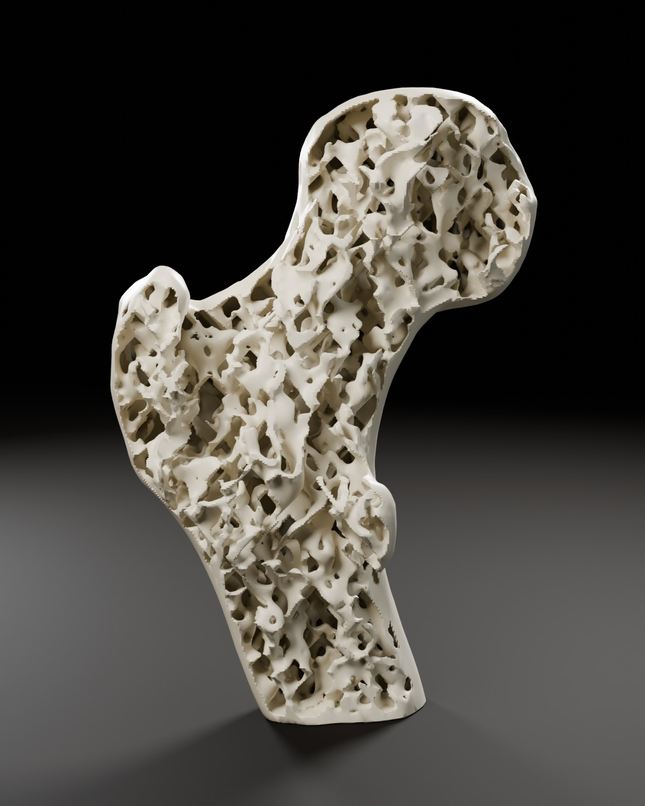

*Femur model: my own. Lattice: generated with bone-infill, my own open-source program.
Images: photos of the real print, and renders of the real files in Blender and by
bone-infill itself; nothing painted by hand.*
